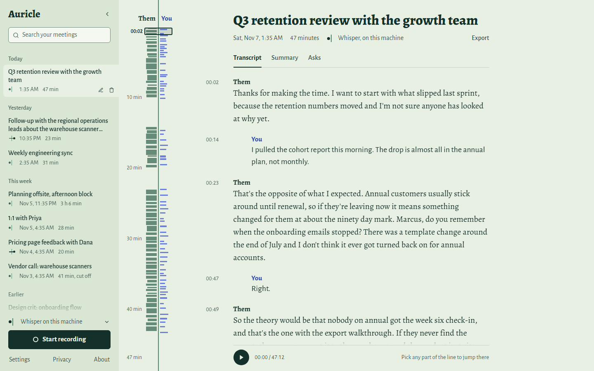

# Auricle

[](https://github.com/ManeeshJupalle/Auricle/releases/latest)
[](https://github.com/ManeeshJupalle/Auricle/releases)
[](LICENSE)

### [⬇ Download for Windows](https://github.com/ManeeshJupalle/Auricle/releases/latest)

Windows 10/11, x64. Grab the `Auricle.Copilot_<version>_x64_en-US.msi` from
the latest release — it installs per-user (no admin prompt) and bundles
everything: the engine, the dashboard, and the copilot overlay.

> **First install:** the installer isn't code-signed yet, so SmartScreen
> will say "Windows protected your PC". Click **More info → Run anyway**.
> After that you're covered: every auto-update the app downloads is
> signature-verified against the key built into it
> ([RELEASING.md](RELEASING.md)).

> **This README tracks `main`.** The latest published release is v0.4.0. The
> session map, the MCP server, and everything else listed above 0.4.0 in the
> [changelog](CHANGELOG.md) arrive with the next release.

<!-- HERO GIF (copilot): docs/demo_copilot.gif — quick-assist over a real meeting: hotkey → context chips → streaming answer → follow-up → Esc -->

**A local-first meeting engine — not another meeting app — that ships
with a desktop copilot.** Auricle is a single Rust binary that captures
your meeting audio (system loopback + microphone, no bot joining your
calls), transcribes it in real time through swappable STT backends, and
exposes everything over a REST/WebSocket API. On top of that API sit two
bundled clients: an embedded web dashboard, and an always-on-top copilot
overlay that can answer "what's happening right now?" from the live
transcript and whatever is on your screen. Privacy by default: with the
local Whisper backend, no audio ever leaves your machine.

> *Auricle: the outer ear — the part of you that listens. It sits on your
> head, not in the cloud.*



Three things, one engine:

- **📝 Meeting notes** — live two-speaker transcript, LLM auto-titles,
  one-click summaries, transcript search, markdown export, optional
  synchronized audio playback.
- **⚡ Copilot** — `Ctrl+Shift+A` mid-meeting: one keystroke captures
  the active window (local OCR) + the last 10 minutes of transcript and
  streams an answer into a small overlay, with context chips naming
  exactly what was captured.
- **🔌 API** — everything above is `curl`-able: REST + WebSocket +
  SSE on one localhost port. The UIs are just clients; yours can be too.
  Turn on the optional MCP server and your coding agent is a client too —
  Claude Code can read the meeting you're in.

## Why

The two incumbent shapes both have the same flaw for personal use: meeting
apps (Meetily) couple capture, inference, and a heavy desktop UI into one
laggy process, and bot platforms (Attendee) put a visible bot in your
meeting and your audio in their cloud. Auricle takes Meetily's virtue
(local, bot-free capture) and Attendee's virtue (API-first, swappable STT)
and ships them as one lightweight daemon.

|  | Meetily | Attendee | **Auricle** |
|---|---|---|---|
| Capture | local system audio + mic | bot joins the meeting | local system audio + mic |
| STT | local only | cloud, swappable | **local + cloud, swappable per session** |
| Interface | the desktop app | REST API | **REST/WS API; dashboard + overlay are just clients** |
| Runtime | Tauri + Next.js | Django/Postgres/Redis fleet | **one ~39 MB binary, SQLite** |
| Audio leaves your machine | no | yes | **only if you opt into a cloud provider** |

## Quickstart

**Engine + dashboard:**

```
# 1. Get auricle:  cargo install auricle-cli   (or grab auricle.exe from Releases)
auricle devices          # see your microphones + loopback outputs
auricle serve            # daemon + web dashboard on http://127.0.0.1:4820

# or skip the server entirely:
auricle record --stt whisper-local --model base.en   # live transcript in your terminal
auricle peek             # OCR the window you're looking at (local, on-demand)
```

Open `http://127.0.0.1:4820`; a first-run setup walks you through picking
audio devices, choosing fully-local vs cloud transcription, and entering
any cloud keys. The dashboard's home screen shows provider readiness, the
copilot hotkeys, and whether anything has left your machine — at a glance.
Then press **Start recording**, play your meeting — the system-audio side
is labeled **Them**, your microphone is **You**, and the two read differently
at a glance: Them in a flush serif, You in an indented sans. One line runs
down every meeting, and it grows live as each side speaks. Red means a session
is recording, and nothing else.
Sessions get LLM auto-titles after stop, and search finds the moment, not just
the meeting: it lists matching lines with their timestamps and takes you there.
On a finished transcript, the **session map** on that line shows who spoke
when, over the whole recording; click anywhere in it to jump the
transcript (and the audio) to that moment. Add synchronized audio playback
when raw-audio retention is on, and one-click summaries (minutes, action
items, standup, 1:1) with a local (Ollama) or cloud LLM. Devices, providers, and keys are all editable later under
**Settings**. Controls take keyboard focus and carry screen-reader labels,
status changes are announced, and arrow keys step through the session map.

**Copilot:** install `Auricle.Copilot_<version>_x64_en-US.msi` from Releases
(per-user, no admin prompt; the engine is bundled and spawns
automatically). Launching the app opens the dashboard in its own window —
the whole product is one installed app, no browser needed. Mid-meeting,
`Ctrl+Shift+Space` summons the ask card, `Ctrl+Shift+A` asks "what's
happening?" in one keystroke, `Esc` dismisses. The tray icon starts/stops
recording and brings the dashboard back. If an engine the app started dies,
the app says so and restarts it, up to five tries in a row; a recording that
was running is closed as interrupted, not resumed, and an `auricle serve` you
started yourself is left alone. Quitting during the app's own recording takes a
second Quit within 10 seconds, which stops it; a recording it doesn't own keeps
running. The app checks for updates on launch and from the tray; every update
is signature-verified before it installs ([RELEASING.md](RELEASING.md)).

**Dictation:** hold `Ctrl+Shift+D` in any app, talk, and let go: the text is
pasted where your cursor was. Your clipboard is put back once that app has
actually read the text; if it never does, the text stays on your clipboard and
the pill says so, so a failed paste never loses your words. A small pill at
the edge of the screen says when it's listening and when it's done, and `Esc`
cancels. Prefer press-to-start, press-to-paste? Put `[dictation]` /
`mode = "toggle"` in `%LOCALAPPDATA%\auricle\overlay.toml` (the dictate key is
`[hotkeys] dictate`). Tray → **Dictation setup** checks the hotkey, the engine,
and which provider will hear you: local `whisper-local` unless you choose
otherwise. Dictation can't start while a meeting is recording. Settings →
Transcription → **Tidy dictation with the LLM above** (off by default) has the
summaries LLM fix punctuation, capitals and filler words before the paste; if
it fails, takes over 8 seconds, or changes what you said instead of tidying it
(answers a question you dictated, summarises, adds words), the text goes in as
heard. When words may be missing (transcription hit an error or fell behind),
the engine's reply says so.

Cloud providers are opt-in via environment variables: `DEEPGRAM_API_KEY`
(streaming STT, the low-latency option), `GROQ_API_KEY` (batch Whisper STT
+ LLM answers/summaries), or any OpenAI-compatible endpoint via config.
Keys can also be stored in the OS credential store (Windows Credential
Manager) through `PUT /api/v1/secrets/{provider}`; resolution prefers the
environment, then the credential store, so nothing is kept in config files.
Local Whisper models download automatically with SHA-256 verification on
first use.

Engine configuration lives in `%LOCALAPPDATA%\auricle\auricle.toml`, picked up
automatically if it exists, including by the engine the app starts; `--config`
points somewhere else. The file in use prints as `using config <path>`, and
anything changed under **Settings** wins over it. A bad value fails a command
only if that command needs the key: `server.bind` for `serve`, `[audio]` for
`capture`, and `[audio]`, the language, and the active provider for `record`.
Anything else wrong, unknown keys included, only warns. A file given with
`--config` must exist and parse. A file that was only found can't fail the
load: if it is broken, or a key the command needs is bad, a warning says so and
the defaults apply. `record` checks its provider after loading, so a bad
provider name or section stops it wherever the file came from.

## The engine

<!-- ENGINE GIF: docs/demo_engine.gif — live dashboard transcript with a mid-sentence provider swap and the latency readout -->

```
 mic ──cpal──► ring buffer ─► resample 16k ─► Silero VAD ─► chunker ─┐
                                                                     ├─► STT provider ─► assembler ─► SQLite
 system audio ─WASAPI loopback─► ring buffer ─► … (same pipeline) ───┘   (trait object)      │
                                                                                             ├─► REST /api/v1
        whisper-local │ deepgram │ groq-whisper │ openai-compat                              └─► WS /ws/live ─► clients
```

- Capture callbacks are allocation-free and lock-free (rtrb ring buffers).
- Silence never reaches STT: Silero VAD gates the stream, with gap-aware
  timestamps (WASAPI loopback delivers *nothing* while the system is
  silent — measured, not assumed).
- Two-channel speaker labels come free from the capture topology.
- A capture device that fails mid-session is reported within about a second,
  on the WebSocket and as a banner in the dashboard. The session keeps running
  on the other channel; the lost device is not reopened.
- Retained audio follows the session timeline: gaps are padded with silence so
  playback lines up with the transcript, and files are flushed every 5 s, so a
  hard kill leaves them playable up to the last flush. A channel's file stops,
  with an `error` event, when its padding would pass 12 h in total, because
  resuming without it would misalign playback, or at a 36 h track length, near
  the most one WAV can hold. The transcript carries on.
- With Deepgram, a short line's final can land 1.5 s or more after the speech
  ends: the server can sit on it until asked, and Auricle asks 1.5 s after the
  last audio. Audio Deepgram never answers is replayed once on a new connection,
  then reported as an `error` and given up on.
- Long summaries are built a portion at a time. If a later portion fails, what
  finished is kept and the summary ends with `[Incomplete: ...]` saying what is
  missing. A local LLM may stay silent for up to an hour before the call gives
  up, because a long prompt on a CPU can take over 10 minutes to start; a cloud
  one gets 10 minutes.
- The daemon defends its localhost boundary: browser requests are
  same-origin enforced (WebSocket handshakes bypass CORS — a foreign page
  cannot read your live transcript) and tokenless loopback binds reject
  non-localhost `Host` headers (DNS rebinding). Bearer tokens are compared
  in constant time, and retained-audio serving is path-contained under the
  engine's sessions directory (defense-in-depth against database tampering).
- The overlay ships a strict webview CSP, and its engine attach validates
  the health payload shape before routing asks — a stray process squatting
  the port is never mistaken for the engine.
- Full API reference with real captured examples: [docs/API.md](docs/API.md).

## The copilot

Auricle can read your screen — deliberately, one frame at a time.
`auricle peek` (or `POST /api/v1/peek`) captures the active window via
Windows.Graphics.Capture, OCRs it with the OS-local Windows.Media.Ocr,
and returns reading-order text. Warm capture→text is 175–300 ms on 1080p
windows ([docs/PHASE7_VISION_REPORT.md](docs/PHASE7_VISION_REPORT.md)).

The assistant service builds on that: `POST /api/v1/ask` combines your
question, an on-demand screen capture, and the last 10 minutes of live
transcript (an in-memory rolling window — no database reads), and streams
an LLM answer as SSE, mirrored on the same WebSocket the dashboard holds.
Follow-ups see your earlier asks from in-memory history. Ollama, Groq, or
any OpenAI-compatible endpoint:

```
curl -N -X POST http://127.0.0.1:4820/api/v1/ask \
  -H "Content-Type: application/json" \
  -d '{"question":"what was just being discussed and what is on my screen?",
       "include_screen":true,"include_transcript":true}'
```

The overlay (`overlay/`, Tauri v2) is the copilot's face: summons in
~100 ms, streams markdown answers, shows **context chips** naming exactly
what was captured, and passes its own window handle to `/ask` so a
capture never reads the overlay's previous answer back into the next
one. It talks only to the public API
([docs/PHASE9_OVERLAY_REPORT.md](docs/PHASE9_OVERLAY_REPORT.md)).

Drag the card by its header and it stays where you put it until the app
restarts. The screen button in the header keeps the next asks, quick assist
included, away from your screen; it is back on at every launch. **New chat**
(the `+`) drops the follow-up history, so the next ask starts clean.

## Agents (MCP)

Auricle can hand your meeting to a coding agent. Turn on **Settings →
Privacy → Let local AI agents read your transcripts** and the daemon
serves an MCP endpoint at `/mcp`; point Claude Code at it:

```
claude mcp add --transport http auricle http://127.0.0.1:4820/mcp
```

Then "what did we just decide about the release date?" is answered from
the meeting you're sitting in, and "summarize last Tuesday's 1:1" from the
one you're not.

Four tools, all read-only: `auricle.live_transcript` (the rolling window of
what's being said right now), `auricle.search` (matching lines across every
recording), `auricle.list_sessions`, and `auricle.get_session`. There is no
tool to start a recording, capture the screen, or spend money on an LLM —
through MCP, an agent gets the transcript and nothing else.

**Off by default, and the ledger tells on it.** Every MCP read is
recorded on the Privacy page as an `AGENT` row naming the client that asked.
Auricle can attest to what it sent; it cannot attest to what a program
that read from it did next, and the ledger says exactly that rather than
filing the read as "stayed local." Full reference:
[docs/API.md](docs/API.md).

## Transparency

The copilot's constraints are design rules, not marketing. The concealment,
surveillance, and privacy-default rules are from the architecture doc,
verbatim:

- **No concealment.** The overlay is a normal window. No
  hide-from-screen-capture tricks (`SetWindowDisplayAffinity` /
  `WDA_EXCLUDEFROMCAPTURE` is out of scope and will not be added). If you
  share your screen, the overlay is visible — that's the point.
- **No continuous surveillance.** Screen capture happens only on explicit
  hotkey press. There is no background screenshot loop, no keylogging, no
  watching.
- **MCP agents only get what you open.** The MCP server is off until you
  turn it on, read-only when on, and every MCP read lands on the ledger under
  its own `AGENT` badge — never counted as "stayed local", because where an
  agent forwards what it read is not something Auricle can see. That toggle
  governs MCP, not local access in general: other processes running as you
  can reach the REST API on loopback with no token, and those reads are not on
  the ledger. See the [trust model](docs/API.md#trust-model).
- **Privacy defaults preserved.** OCR text and questions are processed in
  memory; nothing screen-derived is persisted unless
  `copilot.retain_context = true`. Fully-local operation (Windows OCR +
  Ollama) is the default configuration.
- **You decide how long it stays.** Settings → Your data can delete meetings
  after N days, with their transcripts, summaries, and audio. Off by default,
  permanent (there is no trash), run at every start and once a day, and it
  never touches a meeting in progress. A wrong date could make every meeting
  look expired, so a system clock more than 3 days past the last sweep pauses
  deletion until that reading has held for 7 days; a machine left off that long
  pauses it too. That does not make a wrong clock safe, and what is deleted
  stays deleted: a clock wrong for over 7 days still deletes, and a jump under
  3 days can expire meetings up to 3 days early
  ([details](docs/API.md#get--put-apiv1settings)). **Back up database** writes a
  copy to a `backups` folder beside the database. Retained audio is not in the
  backup, and retention leaves backups alone, so one keeps meetings you delete
  later.
- **Dictation keeps nothing.** The engine can transcribe the mic alone for
  dictation (`/api/v1/dictation/*`). It uses its own `dictation_provider`
  setting, `whisper-local` unless you pick another, so a cloud setup for
  meetings never makes dictation cloud. The text goes back to whoever stopped
  the dictation and nowhere else: no meeting, no transcript line, no audio file,
  nothing an ask or an MCP agent can read. Every `/ws/live` client, the
  dashboard included, sees that a dictation is running and when each part is
  transcribed (`dictation_partial`), but none of its words. A start whose
  caller disconnects before the mic opens never opens it, and a cancel sends
  nothing more to a cloud provider. A dictation stops itself after
  5 minutes. The overlay pastes it through the clipboard and marks it so
  Windows keeps it out of clipboard history (Win+V) and cloud clipboard sync.
  Dictation polish is off by default; turned on with a cloud LLM, the text is
  sent to that LLM, with a ledger row first.
- **Verifiable, not just promised.** The daemon's egress ledger records every
  time it sent user data to a cloud provider — session audio, dictation audio,
  dictation polish, prompt, summary, or auto-title — with the destination and, for text, the rough size, and
  records local-only actions too. Metadata only; contents are never logged. See
  it on the dashboard's **Privacy** page or `GET /api/v1/egress`. It covers the
  daemon only: `auricle record` with a cloud provider writes no ledger rows.
- **Optional PII redaction.** Turn on `redact_pii` (Settings → Privacy) and
  the daemon scrubs transcript text of emails, card/SSN numbers, phone numbers,
  IPs, and API-key-shaped secrets — replaced with visible labels like
  `[email]` — before the text is stored, shown, or sent to an LLM. It works on
  text, so it cannot protect what comes before text exists: a cloud STT
  provider receives the raw audio, and retained WAVs are not redacted. A value
  split across two chunks can't match, and it applies to sessions started after
  you turn it on. Screen OCR and typed questions are not covered.
- **Diagnostics stay local.** Crashes are written to a local file (no
  telemetry, no phone-home). If you hit a bug, the dashboard's **About** tab
  has a "Copy diagnostics" button — a bundle of version + recent crash
  traces (no user content) to attach to an issue, entirely at your choice.

## Performance

Measured on an i7-9750H (2019 6-core laptop) — methodology and budget
misses in [benches/RESULTS.md](benches/RESULTS.md) and the phase reports:

| metric | measured |
|---|---|
| capture → partial, deepgram nova-3 streaming (p50) | **0.14 s** |
| capture → final, deepgram (p50) | **0.54 s** |
| capture → partial / final, groq-whisper batch (p50) | 0.25 s / 0.27 s (p95 5.8 s) |
| capture → partial / final, whisper-local base.en CPU (p50) | 1.9 s / 2.6 s |
| hotkey → screen text ready (warm, 1080p) | 0.18–0.30 s |
| hotkey → overlay visible | **0.09–0.12 s** |
| ask → first answer token, Groq llama-3.3-70b | **0.7 s** |
| ask → first answer token, local Ollama (qwen2.5:14b, warm) | 10.1 s |
| ask → first answer token, local Ollama (qwen3:8b, reasoning) | 104 s |

A Deepgram final after a pause can take longer than this median: see
[The engine](#the-engine).

## Limitations (honest ones)

- **Speaker channels ≠ diarization.** "You"/"Them" comes from which device
  the audio arrived on. Multiple remote speakers are all "Them"; separating
  them needs a pluggable diarizer (roadmap).
- **Windows-only.** The capture, OCR, and overlay layers are
  platform-specific; macOS/Linux are roadmap.
- **A fully-local copilot is slow on modest CPUs.** The measured
  time-to-first-token on a 2019 laptop is 10.1 s with qwen2.5:14b (prompt
  evaluation dominates) and 104 s with qwen3:8b (reasoning models think
  before they speak) — against 0.7 s for Groq. Local answers are private,
  not fast; the numbers and root causes are in
  [docs/PHASE8_ASSISTANT_REPORT.md](docs/PHASE8_ASSISTANT_REPORT.md).
- **Live-transcription quality is provider- and hardware-bound.**
  whisper-local `small.en` cannot keep up with continuous speech on
  2019-class laptop CPUs; `base.en` or a cloud provider are the realistic
  choices there.
- **`base.en`, the default local model, is English-only, and so is
  `small.en`.** Both ignore the language setting, and a session that asks them
  for another language warns you. For other languages, pick the `base` or
  `small` model or a cloud provider.
- **Mic-bleed suppression catches some bleed, not all of it.** On laptop
  speakers the mic hears the far side, so a mic line that repeats a "Them" line
  is dropped and counted in `meta.dropped.bleed_finals`. It only drops a line
  that starts 0 to 500 ms after the matching loopback line, so some bleed still
  comes through as a "You" duplicate: chunks of long speech, whose cuts differ
  per channel; the first lines after loopback silence; a short line (under five
  words); a line that arrives before any matching loopback text; and one that
  spans several loopback lines. The thresholds have not been measured on real
  bleed. It is on by default. With a monitor mix, where your own voice reaches
  the output, a match can delete your words, so set `drop_mic_bleed = false`
  under `[stt]`.
- **Languages written without spaces get less cleanup.** Trimming the overlap
  between chunks and the bleed filter both count words by spaces. In Chinese or
  Japanese, overlap words can repeat where two chunks meet (local and batch
  Whisper), and the bleed filter won't fire on them.
- **On a device with more than two channels, the front pair is what gets
  recorded.** The other channels are used only while that pair is silent, so a
  mic on input 3 of an audio interface is lost whenever inputs 1 and 2 carry any
  signal.
- **Search is a substring match.** Case-insensitive for ASCII only, so
  `MÜLLER` does not find `Müller`. There is no stemming or ranking.
- **Screen-peek OCR is Windows' built-in engine.** Near-perfect on
  article text, honest-but-imperfect on dense small fonts (`auricle` can
  come back as `auride` in a file tree).
- One recording session at a time, by design.
- **Dictation can't type into a window running as administrator.** Windows
  drops keystrokes sent to it without telling the sender, so the overlay
  doesn't try: the text is left on the clipboard for you to paste. In hold
  mode, `Esc` cancels only once you've let go of the keys (with them held it
  would be `Ctrl+Shift+Esc`); before then, letting go pastes.

## Roadmap

- **v0.5 — system-wide dictation: speak into any app.** The capture →
  VAD → STT pipeline already exists; dictation is pointing it at the
  focused window's input.
- macOS capture. Capture is the first blocker, not the only one: the OCR
  reader, the CLI, the `%LOCALAPPDATA%` data paths, and the credential store
  are Windows-bound too.
- Pluggable diarization for multi-speaker separation.
- Vision-LLM screen understanding as an alternative to OCR (the
  `ScreenReader` trait is the extension point).

## Repo layout

`crates/` — core, capture, pipeline, stt, llm, vision, server, cli ·
`ui/` — Vite/React dashboard (embedded into the binary) ·
`overlay/` — Tauri v2 copilot overlay + tray (a pure API client) ·
`shared/` — React code both frontends use ·
`fixtures/` — real captured API payloads driving the tests ·
`benches/` — latency harness + results ·
`docs/` — API reference + phase engineering reports.

MIT licensed. See [BUILDING.md](BUILDING.md) to build from source and
[CONTRIBUTING.md](CONTRIBUTING.md) to contribute.
