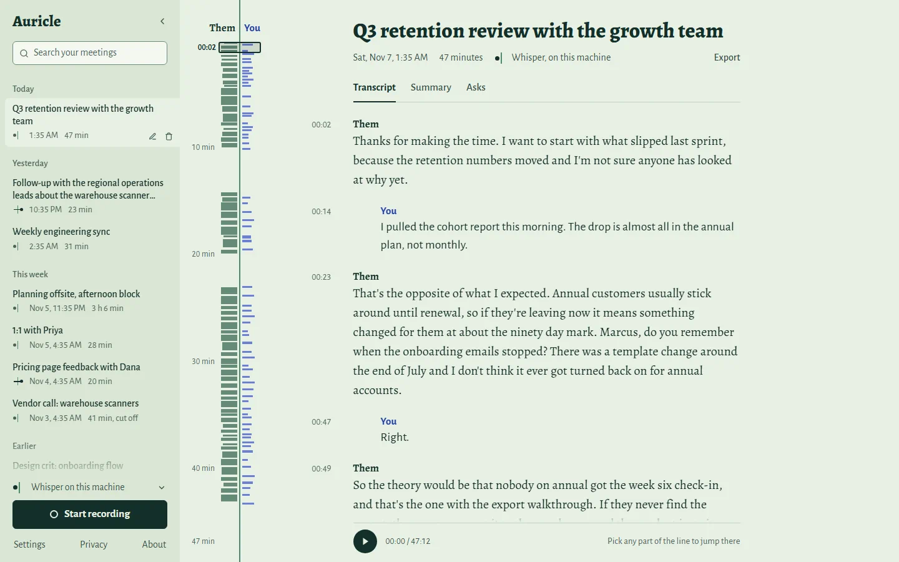
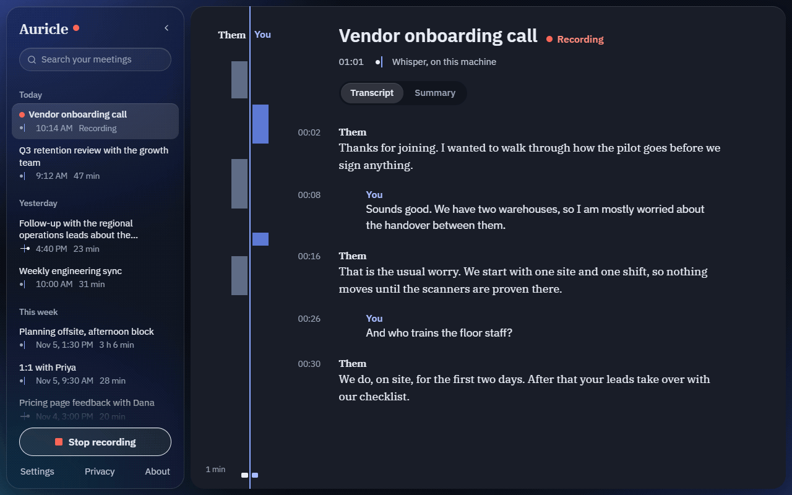
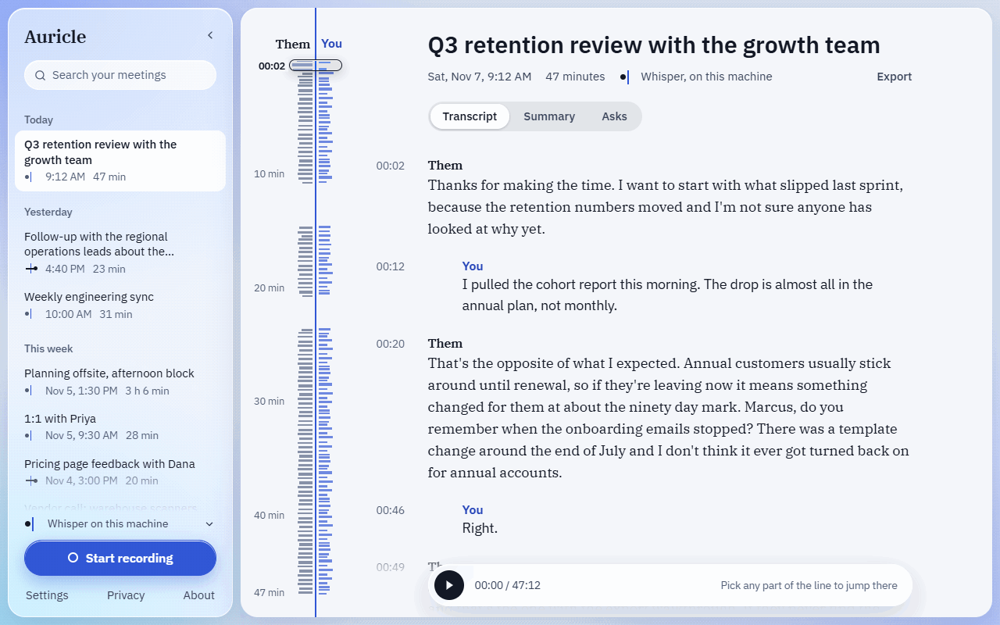
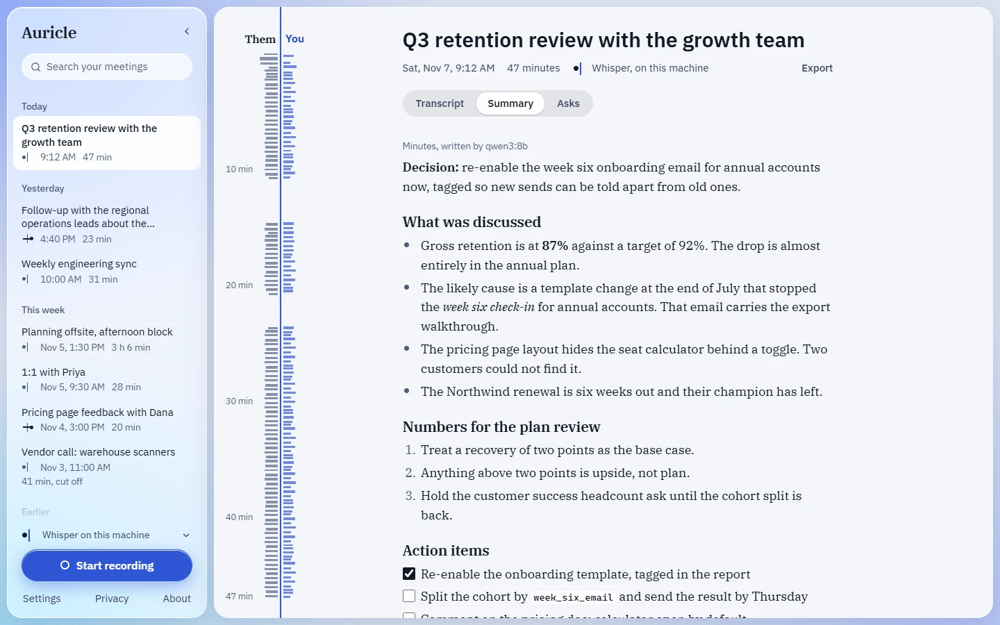
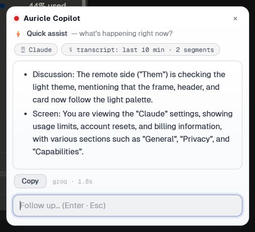
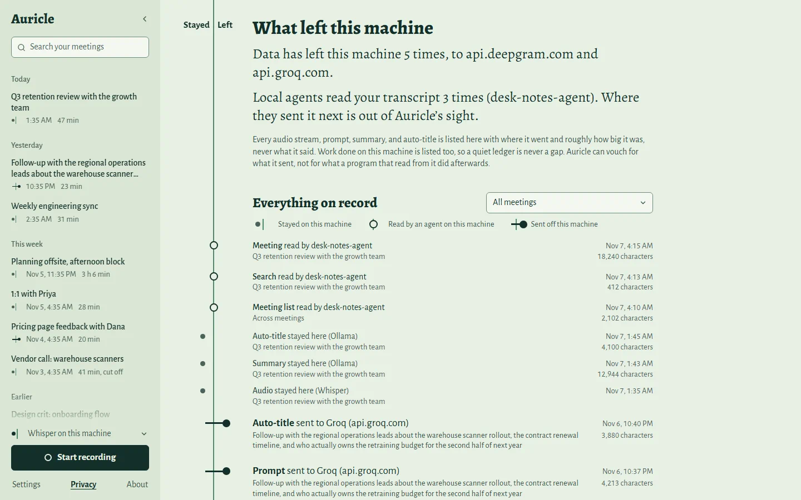
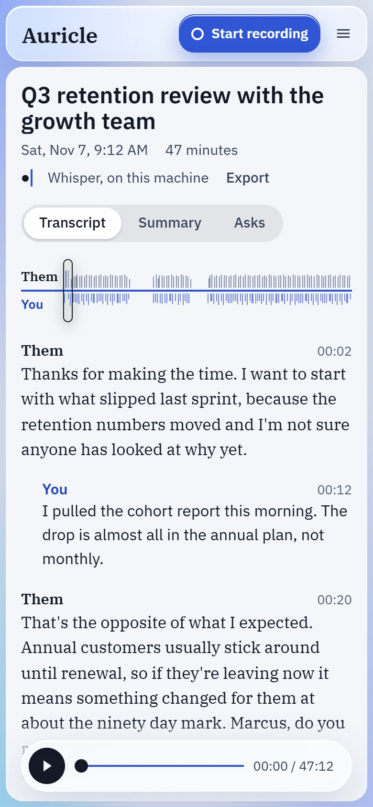

<p align="center">
  
</p>

<h1 align="center">Auricle</h1>

<p align="center">
  <b>The open-source, local-first alternative to Granola and Wispr Flow, for Windows.</b>
</p>

<p align="center">
  Auricle transcribes your calls on your own PC, without a bot joining them, as two voices
  (you and them), summarizes them with a local or cloud model, answers questions about the
  meeting you're in, and types what you dictate into any app.
</p>

<p align="center">
  <a href="https://github.com/ManeeshJupalle/Auricle/releases/latest"></a>
  <a href="https://github.com/ManeeshJupalle/Auricle/releases"></a>
  <a href="https://github.com/ManeeshJupalle/Auricle/actions/workflows/ci.yml"></a>
  <a href="LICENSE"></a>
  <a href="https://github.com/ManeeshJupalle/Auricle/stargazers"></a>
</p>

<p align="center">
  <a href="https://github.com/ManeeshJupalle/Auricle/releases/latest"></a>
  <br>
  <sub>Windows 10/11, x64. Free and MIT-licensed. No account.</sub>
</p>

<p align="center">
  <picture>
    <source media="(prefers-color-scheme: dark)" srcset=".github/assets/transcript-dark.webp">
    
  </picture>
  <br>
  <sub>A finished meeting. Every meeting in the dashboard images and demos below is made up.</sub>
</p>

> **What's in the download today.** The latest release is v0.4.0: meeting
> transcripts, summaries, search, and the copilot. This README tracks `main`:
> dictation, the MCP server, line-level search, retention and backups, and the
> design in these screenshots arrive with the next release. The
> [changelog](CHANGELOG.md) lists everything above 0.4.0.

## Why Auricle

- **Private by default.** Speech is transcribed on your machine by whisper.cpp,
  and summaries come from a local model through [Ollama](https://ollama.com)
  (installed separately). Cloud providers are opt-in, and every time the engine
  sends your data to one, its egress ledger records it.
- **Works with the calls you already have, with no bot.** Auricle records your
  system audio and your microphone, so it works with Zoom, Teams, Meet, or
  anything else that plays through your speakers. Nobody sees a bot join.
- **Your data lives on your machine.** One SQLite database under
  `%LOCALAPPDATA%\auricle`, no account, no telemetry, audio kept only if you turn
  that on, and MIT-licensed code you can read.

## What it does

### Live two-voice transcripts



<sub>Simulated meeting, played to the dashboard by a mock engine.</sub>

Your microphone is **You** and the system audio is **Them**, so the two voices
come apart without diarization. Them reads in a flush serif and You in an
indented sans, and one line runs down every meeting, growing as each side
speaks. Red means a session is recording, and nothing else. Sessions get
LLM auto-titles after stop, and Markdown export.

### Search that finds the moment



<sub>Simulated meetings, served by a mock engine.</sub>

Search lists the matching lines with their timestamps across every meeting,
and picking one opens the meeting there. On a finished transcript, the
**session map** shows who spoke when over the whole recording; click anywhere
in it to jump the transcript there. With raw-audio retention on (it is off by
default), playback follows the transcript and the map seeks the audio too.

### Summaries



One click writes minutes, action items, a standup, or 1:1 notes, with a local
(Ollama) or cloud LLM. Templates are Markdown files, and you can add your own
without recompiling. Long meetings are summarized a portion at a time.

### A copilot for the meeting you're in



<sub>From an earlier build; the card's header now also has New chat, a screen toggle, and it can be dragged.</sub>

Mid-meeting, `Ctrl+Shift+A` captures the active window (OCR'd by Windows,
locally) and the last 10 minutes of transcript, and streams an answer to
"what's happening right now?" into a small always-on-top card. Context chips
name exactly what was captured. `Ctrl+Shift+Space` opens the card to ask
anything, and `Esc` dismisses it.

### Dictation into any app

Hold `Ctrl+Shift+D` in any app, talk, and let go: the text is pasted where your
cursor was, transcribed by local `whisper-local` unless you choose otherwise. A
small pill says when it's listening and when it's done. Nothing is kept: no
meeting, no transcript line, no audio file. *(On `main`; ships with the next
release.)*

### A ledger of everything that left your machine



The Privacy page lists every audio stream, prompt, summary, and auto-title the
engine sent to a cloud provider, with where it went and roughly how big it was,
never what it said, and every read by a local agent over MCP. Work done locally
is listed too, so a quiet ledger is never a gap.

### An engine you can script, and agents can read

Everything above is `curl`-able: REST, WebSocket, and SSE on one localhost
port. The dashboard and the copilot are just clients; yours can be too. Turn on
the optional, read-only MCP server and a coding agent can read the meeting
you're in:

```
claude mcp add --transport http auricle http://127.0.0.1:4820/mcp
```

<details>
<summary>Light, dark, and narrow windows</summary>
<br>


Narrow windows get their own layouts, at 900 px and 640 px. Controls take
keyboard focus and carry screen-reader labels, status changes are announced,
and arrow keys step through the session map. There is no mobile app.
</details>

## How it compares

|  | **Auricle** | Granola | Otter | Wispr Flow | Superwhisper |
|---|---|---|---|---|---|
| Made for | Meetings and dictation | Meeting notes (plus voice typing) | Meeting notes | Dictation (plus a notetaker) | Dictation |
| Platforms | **Windows 10/11 only** | macOS, Windows, iOS, Android | Mac, Windows, iOS, Android, web | Mac, Windows, iOS, Android | Mac, Windows, iOS, Android |
| A bot joins your call | No | No | Yes, its notetaker joins Zoom, Teams, and Meet as a participant | No | Not applicable |
| Where speech becomes text | On your PC by default; a cloud provider only if you pick one | Cloud | Cloud | Cloud, always | Local models that work offline, or optional cloud models |
| Open source | **Yes (MIT)** | No | No | No | No |
| Price | Free | Free tier, paid plans | Free tier, paid plans | Free tier, paid plans | Free tier, paid Pro |

<sub>Other products as described on their own websites in November 2026. They
change; corrections are welcome.</sub>

They run on more platforms, have mobile apps, and offer team plans; Auricle
does none of that. What it offers instead is meetings and dictation in one
app, transcribed locally by default, with the source open.

## Get started

**The app:** download `Auricle.Copilot_<version>_x64_en-US.msi` from the
[latest release](https://github.com/ManeeshJupalle/Auricle/releases/latest).
It installs per-user (no admin prompt) and bundles everything: the engine, the
dashboard, and the copilot overlay. Launching it opens the dashboard in its own
window, and a first-run setup picks your audio devices, fully-local or cloud
transcription, and any cloud keys; all of it can be changed later under
**Settings**. The home screen shows which providers are ready, the copilot
hotkeys, and whether anything has left your machine. Then press **Start
recording** and join your call.

> **First install:** the installer isn't code-signed yet, so SmartScreen says
> "Windows protected your PC". Click **More info → Run anyway**. After that,
> every update the app downloads is signature-verified against the key built
> into it ([RELEASING.md](RELEASING.md)).

**Just the engine:**

```
cargo install auricle-cli    # or build from source: BUILDING.md
auricle devices              # your microphones and loopback outputs
auricle serve                # daemon + web dashboard on http://127.0.0.1:4820

# or skip the server entirely:
auricle record --stt whisper-local --model base.en   # live transcript in your terminal
auricle peek                 # OCR the window you're looking at (local, on demand)
```

Cloud providers are opt-in through environment variables: `DEEPGRAM_API_KEY`
(streaming STT, the low-latency option), `GROQ_API_KEY` (batch Whisper STT,
and LLM answers and summaries), or any OpenAI-compatible endpoint through
config. Keys can also go in Windows Credential Manager through
`PUT /api/v1/secrets/{provider}`; the environment wins, then the credential
store, so no key is kept in a config file. Local Whisper models download on
first use, SHA-256 verified.

<details>
<summary>The app in more detail: hotkeys, the tray, restarts, and updates</summary>

- `Ctrl+Shift+Space` summons the ask card, `Ctrl+Shift+A` asks "what's
  happening?" in one keystroke, `Esc` dismisses. Drag the card by its header
  and it stays where you put it until the app restarts. The screen button in
  the header keeps the next asks, quick assist included, away from your screen;
  it is back on at every launch. **New chat** (the `+`) drops the follow-up
  history, so the next ask starts clean.
- The tray icon starts and stops recording and brings the dashboard back.
- If an engine the app started dies, the app says so and restarts it, up to
  five tries in a row; a recording that was running is closed as interrupted,
  not resumed, and an `auricle serve` you started yourself is left alone.
- Quitting during the app's own recording takes a second Quit within 10
  seconds, which stops it; a recording it doesn't own keeps running.
- The app checks for updates on launch and from the tray; every update is
  signature-verified before it installs ([RELEASING.md](RELEASING.md)).

</details>

<details>
<summary>Dictation in more detail</summary>

- Your clipboard is put back once the target app has actually read the text;
  if it never does, the text stays on your clipboard and the pill says so, so a
  failed paste never loses your words. `Esc` cancels.
- Prefer press-to-start, press-to-paste? Put `[dictation]` / `mode = "toggle"`
  in `%LOCALAPPDATA%\auricle\overlay.toml` (the key is `[hotkeys] dictate`).
- Tray → **Dictation setup** checks the hotkey, the engine, and which provider
  will hear you: local `whisper-local` unless you choose otherwise.
- Dictation can't start while a meeting is recording.
- Settings → Transcription → **Tidy dictation with the LLM above** (off by
  default) has the summaries LLM fix punctuation, capitals and filler words
  before the paste. If it fails, takes over 8 seconds, or changes what you said
  instead of tidying it (answers a question you dictated, summarizes, adds
  words), the text goes in as heard.
- When words may be missing (transcription hit an error or fell behind), the
  engine's reply says so.

</details>

<details>
<summary>The configuration file</summary>

Engine configuration lives in `%LOCALAPPDATA%\auricle\auricle.toml`, picked up
automatically if it exists, including by the engine the app starts; `--config`
points somewhere else. The file in use prints as `using config <path>`, and
anything changed under **Settings** wins over it. A bad value fails a command
only if that command needs the key: `server.bind` for `serve`, `[audio]` for
`capture`, and `[audio]`, the language, and the active provider for `record`.
Anything else wrong, unknown keys included, only warns. A file given with
`--config` must exist and parse. A file that was only found can't fail the
load: if it is broken, or a key the command needs is bad, a warning says so and
the defaults apply. `record` checks its provider after loading, so a bad
provider name or section stops it wherever the file came from.

</details>

## Privacy and transparency

These are design rules, not marketing. The concealment, surveillance, and
privacy-default rules come from the architecture doc.

- **No concealment.** The overlay is a normal window: no hide-from-screen-capture
  tricks (`SetWindowDisplayAffinity` / `WDA_EXCLUDEFROMCAPTURE` is out of scope
  and will not be added). If you share your screen, the overlay is visible.
- **No continuous surveillance.** The screen is captured only on an explicit
  hotkey press. No background screenshot loop, no keylogging.
- **Privacy defaults.** OCR text and questions are processed in memory; nothing
  screen-derived is stored unless `copilot.retain_context = true`. Fully-local
  operation (Windows OCR + Ollama) is the default configuration.
- **Verifiable, not just promised.** The egress ledger records every time the
  daemon sent user data to a cloud provider (session audio, dictation audio,
  dictation polish, prompt, summary, or auto-title) with the destination and,
  for text, the rough size, and records local-only actions too. Metadata only;
  contents are never logged. See the **Privacy** page or `GET /api/v1/egress`.
  It covers the daemon only: `auricle record` with a cloud provider writes no
  ledger rows.
- **MCP agents only get what you open.** The MCP server is off until you turn it
  on, read-only when on, and every read lands on the ledger under its own
  `AGENT` badge, never counted as "stayed local", because where an agent
  forwards what it read is not something Auricle can see. That toggle governs
  MCP, not local access in general: other processes running as you can reach
  the REST API on loopback with no token, and those reads are not on the
  ledger. See the [trust model](docs/API.md#trust-model).
- **Dictation keeps nothing.** It uses its own `dictation_provider` setting,
  `whisper-local` unless you pick another, so a cloud setup for meetings never
  makes dictation cloud. The text goes back to whoever stopped the dictation and
  nowhere else: no meeting, transcript line, or audio file, nothing an ask or an
  MCP agent can read. `/ws/live` clients see that a dictation is running and when
  each part is transcribed, but none of its words. A start whose caller
  disconnects before the mic opens never opens it, a cancel sends nothing more
  to a cloud provider, and a dictation stops itself after 5 minutes. The paste
  goes through the clipboard, marked so Windows keeps it out of clipboard
  history (Win+V) and cloud clipboard sync. Polish is off by default; turned on
  with a cloud LLM, the text is sent there, with a ledger row first.
- **You decide how long it stays.** Settings → Your data can delete meetings
  after N days, with their transcripts, summaries, and audio. Off by default,
  permanent (there is no trash), run at every start and once a day, and never
  touching a meeting in progress. Because a wrong date could make every meeting
  look expired, a clock more than 3 days past the last sweep (before the first
  sweep, past the newest meeting) pauses deletion until that reading has held
  for 7 days; a machine left off that long pauses it too. That doesn't make a
  wrong clock safe: a clock wrong for over 7 days still deletes, and a jump under
  3 days can expire meetings up to 3 days early
  ([details](docs/API.md#get--put-apiv1settings)). **Back up database** writes a
  copy to a `backups` folder beside the database; it doesn't include retained
  audio, and retention leaves backups alone.
- **Optional PII redaction.** `redact_pii` (Settings → Privacy) replaces emails,
  card and SSN numbers, phone numbers, IPs, and API-key-shaped secrets with
  labels like `[email]` before the text is stored, shown, or sent to an LLM. It
  works on text, so a cloud STT provider still receives the raw audio, and
  retained WAVs are not redacted. A value split across two chunks can't match,
  it applies to sessions started after you turn it on, and screen OCR and typed
  questions are not covered.
- **Diagnostics stay local.** Crashes are written to a local file, with no
  telemetry. The **About** tab's "Copy diagnostics" button bundles the version
  and recent crash traces (no user content) for you to attach to an issue, if
  you choose.

## Under the hood

> *Auricle: the outer ear, the part of you that listens. It sits on your head,
> not in the cloud.*

Auricle is a local-first meeting engine, not another meeting app: a single
Rust binary that captures meeting audio, transcribes it in real time through
swappable STT backends, and exposes everything over a REST/WebSocket API. The
dashboard and the copilot overlay are clients of that API.

```
 mic ──cpal──► ring buffer ─► resample 16k ─► Silero VAD ─► chunker ─┐
                                                                     ├─► STT provider ─► assembler ─► SQLite
 system audio ─WASAPI loopback─► ring buffer ─► … (same pipeline) ───┘   (trait object)      │
                                                                                             ├─► REST /api/v1
        whisper-local │ deepgram │ groq-whisper │ openai-compat                              └─► WS /ws/live ─► clients
```

The two usual shapes have the same flaw for personal use: meeting apps
(Meetily) couple capture, inference, and a heavy desktop UI in one process,
and bot platforms (Attendee) put a visible bot in your meeting and your audio
in their cloud. Auricle takes Meetily's virtue (local, bot-free capture) and
Attendee's (API-first, swappable STT) and ships them as one lightweight daemon.

|  | Meetily | Attendee | **Auricle** |
|---|---|---|---|
| Capture | local system audio + mic | bot joins the meeting | local system audio + mic |
| STT | local only | cloud, swappable | **local + cloud, swappable per session** |
| Interface | the desktop app | REST API | **REST/WS API; dashboard + overlay are just clients** |
| Runtime | Tauri + Next.js | Django/Postgres/Redis fleet | **one ~39 MB binary, SQLite** |
| Audio leaves your machine | no | yes | **only if you opt into a cloud provider** |

<details>
<summary>Engine details</summary>

- Capture callbacks are allocation-free and lock-free (rtrb ring buffers).
- Silence never reaches STT: Silero VAD gates the stream, with gap-aware
  timestamps (WASAPI loopback delivers *nothing* while the system is silent;
  measured, not assumed).
- Two-channel speaker labels come free from the capture topology.
- A capture device that fails mid-session is reported within about a second,
  on the WebSocket and as a banner in the dashboard. The session keeps running
  on the other channel; the lost device is not reopened.
- Retained audio follows the session timeline: gaps are padded with silence so
  playback lines up with the transcript, and files are flushed every 5 s, so a
  hard kill leaves them playable up to the last flush. A channel's file stops,
  with an `error` event, when its padding would pass 12 h in total, because
  resuming without it would misalign playback, or at a 36 h track length, near
  the most one WAV can hold. The transcript carries on.
- With Deepgram, a short line's final can land 1.5 s or more after the speech
  ends: the server can sit on it until asked, and Auricle asks 1.5 s after the
  last audio. Audio Deepgram never answers is replayed once on a new connection,
  then reported as an `error` and given up on.
- Long summaries are built a portion at a time. If a later portion fails, what
  finished is kept and the summary ends with `[Incomplete: ...]` saying what is
  missing. A local LLM may stay silent for up to an hour before the call gives
  up, because a long prompt on a CPU can take over 10 minutes to start; a cloud
  one gets 10 minutes.
- The daemon defends its localhost boundary: browser requests are same-origin
  enforced (WebSocket handshakes bypass CORS, so this is what stops a foreign
  page reading your live transcript) and tokenless loopback binds reject
  non-localhost `Host` headers (DNS rebinding). Bearer tokens are compared in
  constant time, and retained-audio serving is path-contained under the
  engine's sessions directory (defense in depth against database tampering).
- The overlay ships a strict webview CSP, and its engine attach validates the
  health payload shape before routing asks, so a stray process squatting the
  port is never mistaken for the engine.

</details>

<details>
<summary>The copilot, from the API</summary>

Auricle reads your screen deliberately, one frame at a time. `auricle peek`
(or `POST /api/v1/peek`) captures the active window via
Windows.Graphics.Capture, OCRs it with the OS-local Windows.Media.Ocr, and
returns reading-order text. Warm capture→text is 175–300 ms on 1080p windows
([docs/PHASE7_VISION_REPORT.md](docs/PHASE7_VISION_REPORT.md)).

`POST /api/v1/ask` combines your question, an on-demand screen capture, and the
last 10 minutes of live transcript (an in-memory rolling window, no database
reads), and streams an LLM answer as SSE, mirrored on the same WebSocket the
dashboard holds. Follow-ups see your earlier asks from in-memory history.
Ollama, Groq, or any OpenAI-compatible endpoint:

```
curl -N -X POST http://127.0.0.1:4820/api/v1/ask \
  -H "Content-Type: application/json" \
  -d '{"question":"what was just being discussed and what is on my screen?",
       "include_screen":true,"include_transcript":true}'
```

The overlay (`overlay/`, Tauri v2) summons in ~100 ms, streams Markdown
answers, and passes its own window handle to `/ask` so a capture never reads
the overlay's previous answer back into the next one. It talks only to the
public API ([docs/PHASE9_OVERLAY_REPORT.md](docs/PHASE9_OVERLAY_REPORT.md)).

</details>

<details>
<summary>Agents over MCP</summary>

Turn on **Settings → Privacy → Let local AI agents read your transcripts** and
the daemon serves an MCP endpoint at `/mcp`. Then "what did we just decide
about the release date?" is answered from the meeting you're sitting in, and
"summarize last Tuesday's 1:1" from the one you're not.

Four tools, all read-only: `auricle.live_transcript` (the rolling window of
what's being said right now), `auricle.search` (matching lines across every
recording), `auricle.list_sessions`, and `auricle.get_session`. There is no
tool to start a recording, capture the screen, or spend money on an LLM:
through MCP, an agent gets the transcript and nothing else.

Every MCP read is recorded on the Privacy page as an `AGENT` row naming the
client that asked. Auricle can attest to what it sent; it cannot attest to what
a program that read from it did next, and the ledger says exactly that rather
than filing the read as "stayed local." Full reference:
[docs/API.md](docs/API.md).

</details>

Full API reference with real captured examples: [docs/API.md](docs/API.md).

## Performance

Measured on an i7-9750H (a 2019 6-core laptop). Methodology and budget misses
are in [benches/RESULTS.md](benches/RESULTS.md) and the phase reports.

| metric | measured |
|---|---|
| capture → partial, deepgram nova-3 streaming (p50) | **0.14 s** |
| capture → final, deepgram (p50) | **0.54 s** |
| capture → partial / final, groq-whisper batch (p50) | 0.25 s / 0.27 s (p95 5.8 s) |
| capture → partial / final, whisper-local base.en CPU (p50) | 1.9 s / 2.6 s |
| hotkey → screen text ready (warm, 1080p) | 0.18–0.30 s |
| hotkey → overlay visible | **0.09–0.12 s** |
| ask → first answer token, Groq llama-3.3-70b | **0.7 s** |
| ask → first answer token, local Ollama (qwen2.5:14b, warm) | 10.1 s |
| ask → first answer token, local Ollama (qwen3:8b, reasoning) | 104 s |

A Deepgram final after a pause can take longer than this median: see
[Engine details](#under-the-hood).

## Limitations (honest ones)

- **Windows only.** The capture, OCR, and overlay layers are
  platform-specific; macOS and Linux are roadmap.
- **Speaker channels ≠ diarization.** "You"/"Them" comes from which device
  the audio arrived on. Multiple remote speakers are all "Them"; separating
  them needs a pluggable diarizer (roadmap).
- **A fully-local copilot is slow on modest CPUs.** The measured
  time-to-first-token on a 2019 laptop is 10.1 s with qwen2.5:14b (prompt
  evaluation dominates) and 104 s with qwen3:8b (reasoning models think
  before they speak), against 0.7 s for Groq. Local answers are private,
  not fast; the numbers and root causes are in
  [docs/PHASE8_ASSISTANT_REPORT.md](docs/PHASE8_ASSISTANT_REPORT.md).
- **Live-transcription quality is provider- and hardware-bound.**
  whisper-local `small.en` cannot keep up with continuous speech on
  2019-class laptop CPUs; `base.en` or a cloud provider are the realistic
  choices there.
- **`base.en`, the default local model, is English-only, and so is
  `small.en`.** Both ignore the language setting, and a session that asks them
  for another language warns you. For other languages, pick the `base` or
  `small` model or a cloud provider.
- **Mic-bleed suppression catches some bleed, not all of it.** On laptop
  speakers the mic hears the far side, so a mic line that repeats a "Them" line
  is dropped and counted in `meta.dropped.bleed_finals`. It only drops a line
  that starts 0 to 500 ms after the matching loopback line, so some bleed still
  comes through as a "You" duplicate: chunks of long speech, whose cuts differ
  per channel; the first lines after loopback silence; a short line (under five
  words); a line that arrives before any matching loopback text; and one that
  spans several loopback lines. The thresholds have not been measured on real
  bleed. It is on by default. With a monitor mix, where your own voice reaches
  the output, a match can delete your words, so set `drop_mic_bleed = false`
  under `[stt]`.
- **Languages written without spaces get less cleanup.** Trimming the overlap
  between chunks and the bleed filter both count words by spaces. In Chinese or
  Japanese, overlap words can repeat where two chunks meet (local and batch
  Whisper), and the bleed filter won't fire on them.
- **On a device with more than two channels, the front pair is what gets
  recorded.** The other channels are used only while that pair is silent, so a
  mic on input 3 of an audio interface is lost whenever inputs 1 and 2 carry any
  signal.
- **Search is a substring match.** Case-insensitive for ASCII only, so
  `MÜLLER` does not find `Müller`. There is no stemming or ranking.
- **Screen-peek OCR is Windows' built-in engine.** Near-perfect on
  article text, honest-but-imperfect on dense small fonts (`auricle` can
  come back as `auride` in a file tree).
- One recording session at a time, by design.
- **Dictation can't type into a window running as administrator.** Windows
  drops keystrokes sent to it without telling the sender, so the overlay
  doesn't try: the text is left on the clipboard for you to paste. In hold
  mode, `Esc` cancels only once you've let go of the keys (with them held it
  would be `Ctrl+Shift+Esc`); before then, letting go pastes.
- **The installer isn't code-signed yet**, so the first install meets a
  SmartScreen prompt (see [Get started](#get-started)).

## FAQ

**Is it really free?** Yes. Auricle is MIT-licensed, with no account and no
paid tier. If you choose a cloud provider (Deepgram, Groq, or another
OpenAI-compatible service), you use your own key and that provider bills you.

**Does anyone on the call know I'm transcribing?** No bot joins, so nothing
announces it. Tell people you're transcribing; the rules on recording
conversations vary by place.

**Do I need a GPU?** No. Local Whisper runs on the CPU, and `base.en` keeps up
on a 2019 laptop; `small.en` doesn't (see Limitations). A GPU build through
Vulkan is wired up but has never been compiled or run
([BUILDING.md](BUILDING.md)).

**Does it work offline?** Yes, with `whisper-local` and a local Ollama model,
once the Whisper model has downloaded.

**What does it connect to on its own?** The app checks GitHub Releases for an
update when it launches, and the engine downloads a Whisper model from Hugging
Face the first time it needs one (SHA-256 verified). Anything else goes out
only if you pick a cloud provider, and the ledger records it.

**Where is my data?** Under `%LOCALAPPDATA%\auricle`: the SQLite database,
retained audio if you turned it on, backups, the config files, and the
engine's log.

**Mac or Linux?** Not yet. Capture comes first, but the OCR reader, the CLI,
the data paths, and the credential store are Windows-bound too.

**Can I build on it?** Yes: REST, WebSocket, and SSE on `127.0.0.1:4820`, and
MCP for agents. Start with [docs/API.md](docs/API.md).

## Roadmap

- **v0.5: system-wide dictation, speaking into any app.** Built and on `main`;
  it ships with the next release.
- macOS capture. Capture is the first blocker, not the only one: the OCR
  reader, the CLI, the `%LOCALAPPDATA%` data paths, and the credential store
  are Windows-bound too.
- Pluggable diarization for multi-speaker separation.
- Vision-LLM screen understanding as an alternative to OCR (the
  `ScreenReader` trait is the extension point).

## Contributing

Bug reports, fixes, and benchmarks from other hardware are all welcome. Start
with [CONTRIBUTING.md](CONTRIBUTING.md), which has a short first-contribution
path, and look for issues labelled
[good first issue](https://github.com/ManeeshJupalle/Auricle/labels/good%20first%20issue).
Please report security problems privately ([SECURITY.md](SECURITY.md)), and see
the [code of conduct](CODE_OF_CONDUCT.md).

**Repo layout:** `crates/`: core, capture, pipeline, stt, llm, vision, server,
cli · `ui/`: Vite/React dashboard (embedded into the binary) · `overlay/`:
Tauri v2 copilot overlay and tray (a pure API client) · `shared/`: React code
both frontends use · `fixtures/`: real captured API payloads driving the
tests · `benches/`: latency harness and results · `docs/`: API reference and
phase engineering reports.

MIT licensed. See [BUILDING.md](BUILDING.md) to build from source.
